# 아키텍처

전체 구조, 데이터 흐름, API·DB 요약입니다. 앱 초기 로딩(Boot) 규칙은 [src/BOOT_ARCHITECTURE.md](../../src/BOOT_ARCHITECTURE.md)를 보세요.

## 데이터 흐름 원칙

- 앱은 외부 API를 **절대 직접 호출하지 않음** — 반드시 자체 백엔드 서버 또는 Vercel BFF를 경유 (자체 백엔드가 대부분을 흡수했고, Vercel은 공공버스·인스타 정적 이미지 갱신만 남음)
- Supabase는 클라이언트에서 직접 연결 (Auth·DB·RPC), 이제 app_config는 다가오는 시간표 변경 배너용 period_schedule만 조회
- FCM 토큰은 네이티브 레이어에서 발급 → Supabase에 저장 → 서버에서 발송

## 소스 코드 구조 (Clean Architecture)

```
src/
├── presentation/      # UI (React 컴포넌트, Hook, Context)
├── domain/            # 비즈니스 로직 (Entity, UseCase, Repository 인터페이스)
├── data/              # 데이터 레이어 (DataSource, Repository 구현체)
├── infrastructure/    # 플랫폼 종속 (HttpClient, SecureStorage)
├── lib/               # 외부 SDK 초기화 (firebase.js, supabase.js, platform.js)
└── di.js              # 의존성 주입 컨테이너
```

## 아키텍처 다이어그램

```mermaid
graph TD
    subgraph Client["📱 클라이언트 (Capacitor)"]
        subgraph WebView["React WebView"]
            UI["UI Layer\n(Presentation)"]
            UC["UseCase Layer\n(Domain)"]
            Repo["Repository Layer\n(Data)"]
        end
        NativeLayer["Native Layer\n(Android / iOS)"]
    end

    subgraph Backend["🖥️ 백엔드 서버 (Spring Boot)"]
        BackendAPI["/api/v1/*\n학식·날씨·도서관·배너·헬스장·\n지하철·셔틀·제휴매장·통합피드백·학사상태"]
    end

    subgraph Vercel["☁️ Vercel (BFF / Serverless) — 이제 이 2개만 프론트가 직접 호출"]
        BusAPI["api/bus.js\n공공버스 도착정보"]
        InstaCron["api/cron/refresh-insta-profiles.js\n인스타 프로필 정적 이미지 갱신(Cron 전용)"]
    end

    subgraph VercelLegacy["☁️ Vercel — 프론트는 안 쓰지만 아직 파일은 있음"]
        MenuAPI["api/menu.js"]
        PortalAPI["api/portal.js"]
        HolidaysAPI["api/holidays.js"]
    end

    subgraph ExternalAPIs["🌐 외부 API"]
        HanyangWeb["한양대학교\n학식 홈페이지"]
        OpenMeteo["Open-Meteo\n날씨 / 대기질"]
        LibraryAPI["한양대 도서관\n좌석 현황"]
        GovHolidayAPI["공공데이터포털\n공휴일 API"]
        GeminiAI["Google Gemini API\n날씨 코멘트 AI"]
        SeoulSubway["서울 열린데이터\n지하철"]
        GyeonggiBus["경기도 버스정보시스템"]
        InstaIG["Instagram\n프로필 API"]
        GithubAPI["GitHub Contents API"]
    end

    subgraph Supabase["🗄️ Supabase (DB + Auth + RPC)"]
        Auth["Auth\n익명 로그인"]
        subgraph Tables["Tables"]
            Devices["devices\nFCM 토큰 등록"]
            Subscriptions["subscriptions\n알림 구독 설정"]
            AppConfig["app_config\n다가오는 시간표 변경 배너용\nperiod_schedule만 보관"]
        end
        RPC["RPC Functions\nupsert_alarm_subscription\nget_alarm_subscription"]
    end

    subgraph Firebase["🔥 Firebase FCM"]
        FCMServer["FCM Server\n푸시 알림 발송"]
    end

    subgraph Monitoring["📊 모니터링"]
        PostHog["PostHog\n사용자 행동 분석"]
        Sentry["Sentry\n에러 모니터링"]
    end

    Repo -->|"fetch /api/v1/*"| BackendAPI
    Repo -->|"fetch /api/bus"| BusAPI

    BackendAPI -->|"학식 스크래핑"| HanyangWeb
    BackendAPI -->|"기상 데이터"| OpenMeteo
    BackendAPI -->|"좌석 현황"| LibraryAPI
    BackendAPI -->|"공휴일 조회"| GovHolidayAPI
    BackendAPI -->|"날씨 코멘트 생성"| GeminiAI
    BackendAPI -->|"지하철 시간표"| SeoulSubway
    BusAPI -->|"도착정보 조회"| GyeonggiBus
    InstaCron -.->|"Vercel Cron, 4개월마다 1회"| InstaIG
    InstaCron -.->|"정적 이미지 커밋"| GithubAPI

    MenuAPI -.->|"menu-alerts Edge Function이\n직접 fetch(프론트는 안 씀)"| HanyangWeb
    PortalAPI -.->|"menu-alerts Edge Function이\ntype=weather만 직접 fetch"| OpenMeteo
    HolidaysAPI -.->|"menu-alerts Edge Function이\n직접 fetch"| GovHolidayAPI

    UI -->|"익명 로그인"| Auth
    UI -->|"다가오는 시간표 변경 일정 조회"| AppConfig
    UI -->|"알림 구독 설정/조회"| RPC
    RPC --> Devices
    RPC --> Subscriptions

    NativeLayer -->|"FCM 토큰 발급"| FCMServer
    UI -->|"토큰 → Supabase 저장"| Devices
    FCMServer -->|"푸시 알림"| NativeLayer

    UI -.->|"이벤트 트래킹"| PostHog
    UI -.->|"에러 리포팅"| Sentry
```



## 백엔드 API (`/api/v1/*`)
<!-- TODO: 엔드포인트별 응답 형태, 캐시 정책, 에러 응답 규약 -->
<!-- TODO: docs/backend-migration-todo.md와의 관계 정리 -->

## Vercel API 엔드포인트 요약

**이 표는 이제 프론트엔드 호출 기준으로는 대부분 사실이 아님 — 학식·날씨·도서관·지하철·셔틀·공휴일 전부 새 백엔드로 이전 완료.** 아래는 남아있는 Vercel 함수 파일과 실제 살아있는 이유.

| 엔드포인트 | 역할 | 외부 호출 대상 | 프론트엔드에서 호출? |
|---|---|---|---|
| `/api/menu` | 학식 HTML 스크래핑 + 파싱 | 한양대 홈페이지 | ❌ `/api/v1/menu`로 대체. Supabase Edge Function `menu-alerts`(푸시 발송)가 직접 호출해서 파일은 살아있음 |
| `/api/portal?type=weather` | 날씨·대기질 + Gemini 코멘트 | Open-Meteo, Gemini | ❌ `/api/v1/weather`로 대체. `menu-alerts`가 직접 호출해서 파일은 살아있음 |
| `/api/portal?type=library` | 도서관 좌석 현황 | 한양대 도서관 API | ❌ `/api/v1/library/seats`로 대체. 이 라우트는 아무도 안 불러서 완전히 죽음 |
| `/api/holidays` | 법정공휴일 여부 조회 | 공공데이터포털 | ❌ `/api/v1/academic/status`로 대체. `menu-alerts`가 직접 호출해서 파일은 살아있음 |
| `/api/bus` | 공공버스 도착 정보 조회 | 공공데이터포털-경기도 버스정보시스템 | ✅ 아직 이 Vercel BFF를 그대로 씀 |
| `/api/cron/refresh-insta-profiles` | 인스타 프로필 사진을 정적 이미지로 주기 갱신(Vercel Cron 전용, HTTP로 직접 호출 안 됨) | Instagram, GitHub Contents API | 해당없음 — 프론트는 결과 정적 이미지만 읽음 |

`/api/insta-proxy`(인스타 프로필 실시간 프록시)는 존재하지 않음 — 위 cron 기반 정적 이미지 방식으로 완전히 교체됨. 학식·날씨·도서관·지하철·셔틀·공휴일 전부 새 백엔드(`/api/v1/menu`, `/api/v1/weather`, `/api/v1/library/seats`, `/api/v1/subway/schedule`, `/api/v1/shuttle`, `/api/v1/academic/status`)로 이전 완료.

## Supabase 테이블 요약

| 테이블 | 용도 |
|---|---|
| `devices` | FCM 토큰 등록 (기기 식별) |
| `subscriptions` | 알림 구독 설정 (학식·날씨 알람 시간/조건) |
| `app_config` | 다가오는 시간표 변경 배너용 `period_schedule`만 조회 — 나머지 셔틀 설정(현재기간·공휴일·강제주말·미운행 오버라이드)은 새 백엔드 `/api/v1/academic/status`로 이전 완료 |

`banners`(앱 내 공지 배너)는 더 이상 Supabase 테이블이 아님 — 새 백엔드 `/api/v1/banners`로 이전 완료.
