# 아키텍처

전체 구조, 데이터 흐름, API·DB 요약입니다. 앱 초기 로딩(Boot) 규칙은 [src/BOOT_ARCHITECTURE.md](../../src/BOOT_ARCHITECTURE.md)를 보세요.

## 데이터 흐름 원칙

- 앱은 외부 API를 **절대 직접 호출하지 않음** — 반드시 자체 백엔드 서버 또는 Vercel BFF를 경유 (자체 백엔드가 대부분을 흡수했고, Vercel은 공공버스·인스타 정적 이미지 갱신만 남음)
- Supabase는 클라이언트에서 직접 연결 (Auth·DB·RPC), 이제 app_config는 다가오는 시간표 변경 배너용 period_schedule만 조회
- FCM 토큰은 네이티브 레이어에서 발급 → Supabase에 저장 → 서버에서 발송

## 소스 코드 구조 (Clean Architecture)

```
src/
├── presentation/      # UI (React 컴포넌트, Hook, Context)
├── domain/            # 비즈니스 로직 (Entity, UseCase, Repository 인터페이스)
├── data/              # 데이터 레이어 (DataSource, Repository 구현체)
├── infrastructure/    # 플랫폼 종속 (HttpClient, SecureStorage)
├── lib/               # 외부 SDK 초기화·공용 설정 (firebase.ts, supabase.ts, platform.ts, queryClient.ts)
└── di.ts              # 의존성 주입 컨테이너
```

## 아키텍처 다이어그램

```mermaid
graph TD
    subgraph Client["📱 클라이언트 (Capacitor)"]
        subgraph WebView["React WebView"]
            UI["UI Layer\n(Presentation)"]
            UC["UseCase Layer\n(Domain)"]
            Repo["Repository Layer\n(Data)"]
        end
        NativeLayer["Native Layer\n(Android / iOS)"]
    end

    subgraph Backend["🖥️ 백엔드 서버 (Spring Boot)"]
        BackendAPI["/api/v1/*\n학식·날씨·도서관·배너·헬스장·\n지하철·셔틀·제휴매장·통합피드백·학사상태"]
    end

    subgraph Vercel["☁️ Vercel (BFF / Serverless) — 이제 이 2개만 프론트가 직접 호출"]
        BusAPI["api/bus.js\n공공버스 도착정보"]
        InstaCron["api/cron/refresh-insta-profiles.js\n인스타 프로필 정적 이미지 갱신(Cron 전용)"]
    end

    subgraph VercelLegacy["☁️ Vercel — 프론트는 안 쓰지만 아직 파일은 있음"]
        MenuAPI["api/menu.js"]
        PortalAPI["api/portal.js"]
        HolidaysAPI["api/holidays.js"]
    end

    subgraph ExternalAPIs["🌐 외부 API"]
        HanyangWeb["한양대학교\n학식 홈페이지"]
        OpenMeteo["Open-Meteo\n날씨 / 대기질"]
        LibraryAPI["한양대 도서관\n좌석 현황"]
        GovHolidayAPI["공공데이터포털\n공휴일 API"]
        GeminiAI["Google Gemini API\n날씨 코멘트 AI"]
        SeoulSubway["서울 열린데이터\n지하철"]
        GyeonggiBus["경기도 버스정보시스템"]
        InstaIG["Instagram\n프로필 API"]
        GithubAPI["GitHub Contents API"]
    end

    subgraph Supabase["🗄️ Supabase (DB + Auth + RPC)"]
        Auth["Auth\n익명 로그인"]
        subgraph Tables["Tables"]
            Devices["devices\nFCM 토큰 등록"]
            Subscriptions["subscriptions\n알림 구독 설정"]
            AppConfig["app_config\n다가오는 시간표 변경 배너용\nperiod_schedule만 보관"]
        end
        RPC["RPC Functions\nupsert_alarm_subscription\nget_alarm_subscription"]
    end

    subgraph Firebase["🔥 Firebase FCM"]
        FCMServer["FCM Server\n푸시 알림 발송"]
    end

    subgraph Monitoring["📊 모니터링"]
        PostHog["PostHog\n사용자 행동 분석"]
        Sentry["Sentry\n에러 모니터링"]
    end

    Repo -->|"fetch /api/v1/*"| BackendAPI
    Repo -->|"fetch /api/bus"| BusAPI

    BackendAPI -->|"학식 스크래핑"| HanyangWeb
    BackendAPI -->|"기상 데이터"| OpenMeteo
    BackendAPI -->|"좌석 현황"| LibraryAPI
    BackendAPI -->|"공휴일 조회"| GovHolidayAPI
    BackendAPI -->|"날씨 코멘트 생성"| GeminiAI
    BackendAPI -->|"지하철 시간표"| SeoulSubway
    BusAPI -->|"도착정보 조회"| GyeonggiBus
    InstaCron -.->|"Vercel Cron, 4개월마다 1회"| InstaIG
    InstaCron -.->|"정적 이미지 커밋"| GithubAPI

    MenuAPI -.->|"menu-alerts Edge Function이\n직접 fetch(프론트는 안 씀)"| HanyangWeb
    PortalAPI -.->|"menu-alerts Edge Function이\ntype=weather만 직접 fetch"| OpenMeteo
    HolidaysAPI -.->|"menu-alerts Edge Function이\n직접 fetch"| GovHolidayAPI

    UI -->|"익명 로그인"| Auth
    UI -->|"다가오는 시간표 변경 일정 조회"| AppConfig
    UI -->|"알림 구독 설정/조회"| RPC
    RPC --> Devices
    RPC --> Subscriptions

    NativeLayer -->|"FCM 토큰 발급"| FCMServer
    UI -->|"토큰 → Supabase 저장"| Devices
    FCMServer -->|"푸시 알림"| NativeLayer

    UI -.->|"이벤트 트래킹"| PostHog
    UI -.->|"에러 리포팅"| Sentry
```



## 백엔드 API (`/api/v1/*`)

백엔드를 바꿀 때 프론트의 어디가 영향받는지 정리합니다. 캐시 TTL·staleTime은 [caching.md](caching.md), 프론트에서 새 API를 연결하는 방법은 [conventions.md](conventions.md)에 있습니다.

### 호출 경로
- 프론트는 `src/di.ts`의 `apiHttpClient` 하나로 새 백엔드를 부릅니다. 운영 빌드는 `VITE_API_BASE_URL`로 직접, 로컬 `npm run dev`는 `/backend`로 보내서 Vite 프록시가 `VITE_API_BASE_URL`로 넘깁니다.
- 로컬 프록시는 **`Origin`·`Referer` 헤더를 떼고** 보냅니다(`vite.config`). 그대로 넘기면 Spring CORS 필터가 프록시 요청도 403으로 막기 때문입니다.
- 앱(Android/iOS)의 WebView는 `capacitor.config.json`의 `server.url`인 `https://www.hanyang.life`를 띄웁니다. 그래서 웹과 앱 모두 요청 Origin이 이 도메인입니다. **백엔드 CORS 허용 목록에 이 도메인이 있어야 합니다.**
- 모든 요청은 15초 안에 응답 헤더가 안 오면 끊습니다(`HttpClient.ts`).

### 응답 형식 (프론트가 기대하는 것)

```json
{ "success": true, "data": { ... } }
{ "success": false, "error": { "code": "PL005", "message": "..." } }
```

- HTTP 4xx/5xx면 `parseOrThrow`가 에러를 던집니다. 이때 `error.code`, `error.message`(없으면 `message`), `Retry-After` 헤더를 읽습니다.
- HTTP 200이어도 `success: false`면 Repository가 에러로 던집니다.
- 정적 JSON(`/campusBuildings.json` 등)은 이 형식이 아니라 배열을 그대로 받습니다.

### 응답을 바꿀 때 영향

| 변경 | 프론트 영향 |
|---|---|
| 필드 **추가** | 안전합니다. 프론트는 모르는 필드를 무시합니다. |
| enum에 **새 값 추가** | 대부분 안전합니다. 라벨 매핑에 없는 값은 원본 문자열 그대로 화면에 나옵니다(예: 셔틀 노선). |
| 필드 **이름 변경·삭제·타입 변경** | 해당 Repository·Schema 수정이 필요합니다. zod 검증을 쓰는 곳(학식·셔틀·도서관 등)은 그 항목이 조용히 빠지거나 에러 화면이 뜹니다. Entity 모양이 바뀌면 `CACHE_BUSTER`도 올려야 합니다([conventions.md](conventions.md)). |
| 학식 API 변경 | **푸시 알림에는 반영되지 않습니다.** 학식·날씨 푸시를 보내는 Supabase Edge Function `menu-alerts`는 아직 구 Vercel `/api/menu`·`/api/portal?type=weather`·`/api/holidays`를 직접 부릅니다(아래 Vercel 표). |

### 프론트가 특별 처리하는 에러 코드

일반 에러는 화면에 "다시 시도"를 보여주고 Sentry로 보냅니다. 아래 코드는 프론트가 의미를 알고 따로 처리하므로, **코드 값이나 HTTP 상태를 바꾸면 프론트도 같이 고쳐야 합니다.**

| 코드 | HTTP | 프론트 동작 | 위치 |
|---|---|---|---|
| `C003` | 404 | 곡별 게시글 조회: "게시글 0개"인 정상 빈 결과로 바꿈. 재생수 기록: Sentry에 안 보냄 | `PlaylistRepository.ts`, `queryClient.ts` |
| `PL005`, `PL006` | 429 | 검색·Spotify 사용량 제한. Sentry에 안 보내고 `Retry-After`만큼 버튼을 막음 | `queryClient.ts`, `useMusicSearch.ts` |
| `PL003`, `C001` | — | 곡 추천 폼 아래에 안내 문구 표시 | `RecommendSongView.tsx` |
| `C004`, `PL008` | — | 곡 추천: 다시 시도 가능한 에러로 안내 | `RecommendSongView.tsx` |
| `PT001` 등 | 400·404·409 | 프린터 제보: 상태별로 안내 문구 분기, 409·404면 목록을 다시 받음 | `PrinterRepository.ts`, `IPrinterRepository.ts` |

### 엔드포인트 → 화면

| 엔드포인트 | 메서드 | 쓰는 화면 | DataSource |
|---|---|---|---|
| `/api/v1/menu` | GET | 학식 탭 | `MenuApiDataSource` |
| `/api/v1/shuttle` | GET | 셔틀·지하철 탭 | `ShuttleApiDataSource` |
| `/api/v1/subway/schedule` | GET | 셔틀·지하철 탭(기숙사·셔틀콕 정류장) | `SubwayApiDataSource` |
| `/api/v1/academic/status` | GET | 부팅(스플래시), 셔틀·지하철 탭 | `AcademicStatusApiDataSource` |
| `/api/v1/holidays/date-info` | GET | 셔틀·지하철 탭(지하철 연결편) | `DateInfoApiDataSource` |
| `/api/v1/weather` | GET | 소식 탭 | `WeatherApiDataSource` |
| `/api/v1/weather/briefing` | GET | 소식 탭 | `WeatherBriefingApiDataSource` |
| `/api/v1/library/seats` | GET | 소식 탭 | `LibraryApiDataSource` |
| `/api/v1/banners` | GET | 소식 탭 캐러셀, 스플래시 | `BannerApiDataSource` |
| `/api/v1/gym/gym-periods` | GET | 기타 탭 > 헬스장 | `GymApiDataSource` |
| `/api/v1/feedbacks` | POST | 기타 탭 > 피드백, 캠퍼스맵·동아리·학식 제보 | `FeedbackApiDataSource` |
| `/api/v1/partnership/partnership-available` | GET | 캠퍼스맵 탭 | `PartnerStoreApiDataSource` |
| `/api/v1/campus-map/printers`, `/{id}` | GET | 캠퍼스맵 탭 > 프린터 | `PrinterApiDataSource` |
| `/api/v1/campus-map/printer-reports`, `/printers/{id}/reports` | POST | 캠퍼스맵 탭 > 프린터 제보 | `PrinterApiDataSource` |
| `/api/v1/playlist/songs` 외 | GET·POST | 기타 탭 > 플레이리스트 (목록·상세·검색·차트·등록·신고·좋아요·재생수·리액션) | `PlaylistApiDataSource` |
| `/api/v1/playlist/recommendations` | GET | 플레이리스트 아티스트 추천 | `PlaylistApiDataSource` |
| `/api/v1/playlist/catalog/tracks/search` | GET | 곡 추천하기 검색 | `MusicSearchApiDataSource` |

엔드포인트 전체 목록은 `src/data/datasources/*.ts`에서 `httpClient.get`·`httpClient.post`로 찾을 수 있습니다.

### 이전 작업 문서와의 관계
Vercel BFF → 새 백엔드 이전의 남은 작업은 [docs/backend-migration-todo.md](../backend-migration-todo.md)에 있습니다. 이전이 끝난 결과(현재 상태)는 이 문서에 반영합니다.

## Vercel API 엔드포인트 요약

**이 표는 이제 프론트엔드 호출 기준으로는 대부분 사실이 아님 — 학식·날씨·도서관·지하철·셔틀·공휴일 전부 새 백엔드로 이전 완료.** 아래는 남아있는 Vercel 함수 파일과 실제 살아있는 이유.

| 엔드포인트 | 역할 | 외부 호출 대상 | 프론트엔드에서 호출? |
|---|---|---|---|
| `/api/menu` | 학식 HTML 스크래핑 + 파싱 | 한양대 홈페이지 | ❌ `/api/v1/menu`로 대체. Supabase Edge Function `menu-alerts`(푸시 발송)가 직접 호출해서 파일은 살아있음 |
| `/api/portal?type=weather` | 날씨·대기질 + Gemini 코멘트 | Open-Meteo, Gemini | ❌ `/api/v1/weather`로 대체. `menu-alerts`가 직접 호출해서 파일은 살아있음 |
| `/api/portal?type=library` | 도서관 좌석 현황 | 한양대 도서관 API | ❌ `/api/v1/library/seats`로 대체. 이 라우트는 아무도 안 불러서 완전히 죽음 |
| `/api/holidays` | 법정공휴일 여부 조회 | 공공데이터포털 | ❌ `/api/v1/academic/status`로 대체. `menu-alerts`가 직접 호출해서 파일은 살아있음 |
| `/api/bus` | 공공버스 도착 정보 조회 | 공공데이터포털-경기도 버스정보시스템 | ✅ 아직 이 Vercel BFF를 그대로 씀 |
| `/api/cron/refresh-insta-profiles` | 인스타 프로필 사진을 정적 이미지로 주기 갱신(Vercel Cron, 4개월마다 1회) | Instagram, GitHub Contents API | 해당없음 — 프론트는 결과 정적 이미지만 읽음 |
| `/api/ux-writing` | 개발용 UX 문구 검토 오버레이 | Gemini | 개발 도구(`src/devtools/ux-writing`)에서만 사용 |
| `/api/sentry-discord-webhook` | Sentry 이슈 알림을 Discord로 중계(서명 검증) | Discord | 해당없음 — 앱이 아니라 Sentry가 호출 |

`/api/music-search`·`/api/music`(Spotify 곡 검색)은 백엔드 `/api/v1/playlist/catalog/tracks/search`로 대체된 뒤 아무도 호출하지 않아 2026-11-08에 삭제함(`api/_lib/spotifyAuth.js` 포함). `/api/insta-proxy`(인스타 프로필 실시간 프록시)는 존재하지 않음 — 위 cron 기반 정적 이미지 방식으로 완전히 교체됨. 학식·날씨·도서관·지하철·셔틀·공휴일 전부 새 백엔드(`/api/v1/menu`, `/api/v1/weather`, `/api/v1/library/seats`, `/api/v1/subway/schedule`, `/api/v1/shuttle`, `/api/v1/academic/status`)로 이전 완료.

## Supabase 테이블 요약

| 테이블 | 용도 |
|---|---|
| `devices` | FCM 토큰 등록 (기기 식별) |
| `subscriptions` | 알림 구독 설정 (학식·날씨 알람 시간/조건) |
| `app_config` | 다가오는 시간표 변경 배너용 `period_schedule`만 조회 — 나머지 셔틀 설정(현재기간·공휴일·강제주말·미운행 오버라이드)은 새 백엔드 `/api/v1/academic/status`로 이전 완료 |

`banners`(앱 내 공지 배너)는 더 이상 Supabase 테이블이 아님 — 새 백엔드 `/api/v1/banners`로 이전 완료.
